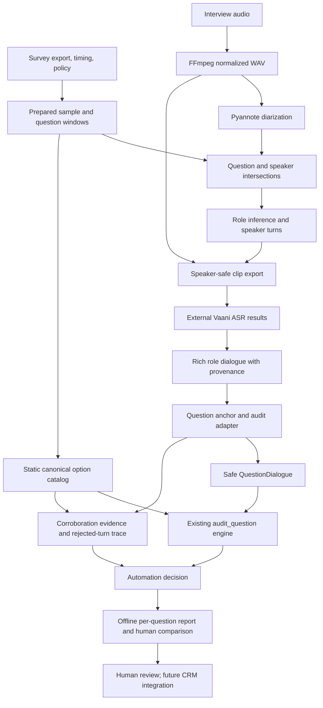

# Technical architecture

## System boundary

Python modules and offline CLI scripts transform local survey exports, audio,
policy snapshots, and ASR results into JSON evidence reports. There is no
implemented web service, database-backed application, queue, or CRM writeback.
Pydantic models define core contracts; richer full-sample artifacts use dicts.

Question-window ASR/chunk merging is also available for diagnostics. Its merged
text does not replace role-specific dialogue in the safe audit path. Whisper
is a local comparison baseline; Vaani is the selected experimental Hindi baseline.
ASR execution is a separate step, not performed by the full-sample audit runner.

## Contracts and responsibilities

| Boundary | Contract / responsibility |
| --- | --- |
| Request | `SurveyAuditRequest`, `SurveyQuestion`: identity, language, choices, stored answer, optional timing |
| Policy | `AuditProjectPolicy` → `AuditTagPolicy` → nested `DispositionNode`; preserve IDs and project scope |
| Audio/ASR | Normalized WAV, timestamped chunks, manifests, raw transcript and explicit completion status |
| Rich dialogue | Tagged turns with role, speaker ID, times, transcript, ASR status and overlap provenance |
| Adapter | `SafeAuditInputs`: safe dialogue, corroboration turns, `SafeAuditTrace` |
| Core audit | `QuestionAuditResult`: evidence, validation/resolution, prompting and disposition suggestions |
| Evidence | `CorroboratedEvidenceResult`: support, conflict, unsafe turn IDs and review reasons |
| Automation | `QuestionAutomationDecision`: `AUTO_FILL`, `PREFILL`, or `HUMAN_REVIEW`, proposals and unresolved sides |
| Batch report | Versioned JSON with per-tag results, missing/inactive cases, action counts and human comparisons |

## Evidence integrity

The adapter selects an agent question anchor using question text and window
tolerance. An anchor must have a real start timestamp. It excludes pre-anchor
evidence and unsafe turns from the core audit dialogue. Material unsafe turns
remain in corroboration and the rejection trace; an unsafe anchor clears the
safe dialogue. Missing timestamps remain `None`. Tiny skipped turns need not
force review; meaningful overlap does. Upstream review can downgrade an otherwise
automatic result to prefill.

The core engine extracts agent question text, initial respondent response,
intervening agent follow-up, and final respondent response. In the
full-sample runner, question validation uses `question_validation/script_match.py`
(see below); elsewhere it uses fuzzy similarity. Answer resolution uses canonical choices and, for
respondent text, requires the utterance as a whole to match an option, so an
option word inside a longer statement is left for review. Prompting-aware
mapping requires explicit policy paths. Confidence/similarity values are scores,
not calibrated probabilities.

Turn export (`export_interview_turns.py`) builds speaker turns once for the
whole interview and transcribes each once, so boundary turns are no longer cut
or repeated and speech between audited questions is transcribed. Loud
stretches with no diarized speaker become `unattributed` turns (role unknown):
shown to auditors, never used for automatic decisions. Questions reference the
turns overlapping their windows with window-clipped timing.

Paraphrase-tolerant question validation (`script_match.py`, runner default,
`script_matching=False` restores the fuzzy check) measures weighted coverage of
the question's content in interviewer speech. The script is cleaned to its
spoken form (instructions and placeholders removed, piped answers filled,
digits as Hindi words); words are weighted by inverse frequency across the
questionnaire, with introductory sentences at 0.1 and piped names at 0.5; words
match through stemming, consonant skeletons, joined compounds, a small synonym
list and observed ASR merges ("कोर्ट" = "को वोट"). Every interviewer passage from
5 s before the window is scored. Asked Right needs coverage ≥ 0.70 and the
passage must fit the question at least as well as each look-alike question on
the words that differ. One option named by the interviewer on a do-not-read
question withholds it; several named options, a missing question word or an
overlapping voice limit it to prefill. Thresholds were set on four audited
interviews and checked on three others. It is string processing only.

Anchor selection and question validation have different scoring/normalization
and thresholds. A found anchor is not proof the question was asked correctly.
Speaker clustering and role inference are also separate: speaker IDs alone
do not identify interviewer/respondent, and extra speakers remain possible.

## Full-sample runner

`scripts/evaluate_full_sample_audit.py` reads five prepared files:

- `prompting_dialogue_clean.json`
- `question_asr.json`
- `survey_definition.json`
- `audit_policy_snapshot.json`
- `human_audit.json`

It parses a single-project policy snapshot, indexes inputs by tag, uses survey
definition wording as authoritative, and invokes `run_full_question_audit()`.
Duplicate tags and policy scope mismatch raise errors. Missing inputs and inactive
policies produce explicit rows. Only static resolution-ready catalogs supply
options; dynamic choices are not fabricated.

The output `full_sample_audit.json` contains audit, corroboration, automation,
trace, and question/answer comparisons. Human `selectedOptions` keys are ordering
indices, not disposition IDs. Ordered label paths are compared exactly, falling
back to single suggestion text when no path is provided. Unlabeled, unsupported,
and no-suggestion cases are distinct from matches/mismatches. Human labels are
used for comparison after inference, not as answer evidence.

## Runtime and limitations

Python 3.12 is the currently used environment. `requirements.txt` is unpinned
and does not fully specify the ML runtime: Pyannote, NumPy and NeMo availability
must be checked separately. FFmpeg must be available for normalization/export.
Pyannote uses `HF_TOKEN` and loads PCM waveform directly to avoid dependence on
its default file decoder. Never print or commit the token.

`notebooks/vaani_baseline.ipynb` is the Colab Vaani workflow: it validates
uploaded clips against the turn manifest and writes `{audio_file, transcript}`
results plus a coverage/runtime report. It runs outside the local environment and
is committed without outputs. NeMo is not pinned.
There is no locked environment or deployment definition. Some scripts assume
private file locations or a limited default tag list; inspect `--help` and source.

Current gaps include complete clean-dialogue coverage, dynamic choice resolution,
configurable survey-to-audit tag mapping, explicit prompting paths in the batch
runner, broader manual evaluation, and production integration. Existing adapters
are conservative heuristics and need benchmark evidence before generalization.
